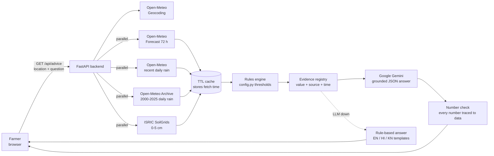

# YieldGuard – Multilingual Agritech Risk Advisor

YieldGuard gives Karnataka farmers plain-language, crop-level protective advice from **live** weather, rainfall-history and soil data, in **English, Hindi or Kannada**.

Type a village or town, ask a question in your language, and get:

- **Spray windows**: the next safe hours to spray, based on wind and rain.
- **Heavy-rain warnings** for the next 24 hours.
- **Rainfall vs normal**: this month's rain compared with the 2000–2025 average for the same dates (drought or waterlogging risk).
- **Soil-aware tips** from SoilGrids topsoil sand, clay and pH at your coordinates.
- A **"why" section** that shows every data point used, with its **source and fetch time**, and the rule that was applied.

> Built for the Climate, Resource Infrastructure & Global Supply Resilience buildathon (problem: Multilingual Agritech & Resource Advisory Assistant).

**Live app:** `<add your Render URL here>`

---

## How it works



1. **Resolve location** with Open-Meteo Geocoding, restricted to Karnataka (or use browser GPS coordinates).
2. **Fetch in parallel**: the 72-hour forecast, month-to-date rainfall, a 26-year rainfall archive, and SoilGrids topsoil. Each call has an 8 s timeout and one retry (the large archive call gets 25 s). Responses are cached with their original fetch time.
3. **Apply rules** from [`backend/app/config.py`](backend/app/config.py) (spray window, heavy rain, rainfall deficit, soil).
4. **Build the evidence registry**: every number gets an id, label, value, unit, the time it refers to, its source and its fetch time.
5. **Language model** (Google Gemini, `gemini-3.5-flash-lite`, retrying once on `gemini-3.8-flash` if it is rate-limited, overloaded or slow) gets only that evidence plus the rule outcomes and must return structured JSON whose recommendations cite evidence ids. Unknown ids are removed.
6. **Grounding check**: every number in the answer is matched against the retrieved data. Any number that can't be matched is shown to the user as "check these numbers".
7. **Failure handling**: if a source fails, the answer says which one and which parts are missing. If the language model fails, a deterministic rule-based answer is returned in the user's language.

### Project layout

```
backend/
  app/
    config.py        all thresholds, URLs, timeouts, cache TTLs
    http.py          fetch with timeout + 1 retry, caching, SourceResult
    cache.py         TTL cache that keeps fetch time
    sources/         geocode, forecast, rainfall (MTD + baseline), soil
    rules/           spray, heavy_rain, deficit, soil
    evidence.py      data points + rule outcomes with source and time
    prompts.py       system prompt + JSON output schema
    llm.py           Gemini call (JSON schema output, fallback model on rate limit)
    fallback.py      rule-based answer in EN / HI / KN
    grounding.py     numbers-in-answer verification
    language.py      script-based language detection
    advisor.py       orchestration for one request
    main.py          FastAPI app and routes, serves the frontend
  tests/             67 tests; fixtures are real API responses (tests only)
frontend/            index.html, app.js, chart.js, i18n.js, voice.js, styles.css
render.yaml          deployment blueprint (no secrets)
```

---

## Data sources and attribution

| Data | Source | Notes |
|---|---|---|
| Place → coordinates | [Open-Meteo Geocoding API](https://open-meteo.com/en/docs/geocoding-api) | Filtered to Karnataka, larger towns first |
| 72-hour hourly forecast | [Open-Meteo Forecast API](https://open-meteo.com/en/docs) | `temperature_2m, relative_humidity_2m, precipitation_probability, precipitation, wind_speed_10m`, `timezone=Asia/Kolkata`, `forecast_days=3` |
| Month-to-date rainfall | Open-Meteo Forecast API (`start_date`/`end_date`, `daily=precipitation_sum`) | Recent days without the archive's ~5-day lag |
| Long-run rainfall baseline | [Open-Meteo Historical Weather API](https://open-meteo.com/en/docs/historical-weather-api) | 2000 to last full year, same calendar dates; cached 7 days |
| Topsoil properties | [ISRIC SoilGrids v2.0](https://rest.isric.org/soilgrids/v2.0/docs) | `clay, sand, phh2o, soc`, `depth=0-5cm`, `value=mean`; cached 30 days |
| Answer writing | [Google Gemini API](https://ai.google.dev/) | Uses only the data above. Free tier: prompts may be used by Google to improve its products, so only public weather/soil data and the question are sent. |

**Attribution:** Weather data by [Open-Meteo.com](https://open-meteo.com/), licensed [CC BY 4.0](https://creativecommons.org/licenses/by/4.0/). Soil data: SoilGrids v2.0, [ISRIC – World Soil Information](https://www.isric.org/), CC BY 4.0.

**SoilGrids unit conversion:** values are stored as integers scaled by `d_factor` (read from each response): clay and sand g/kg ÷ 10 → %, pH × 10 ÷ 10 → pH, SOC dg/kg ÷ 10 → g/kg.

**Urban pixels:** SoilGrids masks built-up areas (for example, Dharwad city centre returns `null`). We then query points about 2 km away, one at a time to respect ISRIC's fair-use limit, and show the distance used ("2.2 km from the location").

**Rainfall caveat:** month-to-date rain comes from the forecast model's recent analysis and the baseline from ERA5 reanalysis. Both are gridded model estimates, not rain-gauge readings.

---

## Advisory rules

All thresholds are in [`backend/app/config.py`](backend/app/config.py) and also served live at `GET /api/rules`.

| Rule | Condition | Advice |
|---|---|---|
| Spray window | `wind_speed_10m < 10 km/h` AND `precipitation_probability < 20%` AND `precipitation = 0`, for **≥ 3 consecutive hours**, daylight 06:00–19:00 only (`SPRAY_ALLOWED_HOURS`, set `None` to allow any hour). Missing values count as unsafe. | Earliest 1–3 windows |
| Heavy rain | Next 24 h: any hour `precipitation_probability > 70%` OR total rain `> 40 mm` | Postpone field work, check drainage |
| Rainfall deficit | Month-to-date rain (1st to yesterday) as % of the 2000–2025 mean for the same dates. On the 1st, the previous full month is used. | `< 60%` drought risk, `> 150%` waterlogging risk. If normal rain is below 5 mm (dry season), no % is given. |
| Soil | sand `> 60%`; clay `> 40%`; pH `< 5.5` or `> 8.5` | Lighter, more frequent irrigation; caution in heavy rain; get a soil test |

---

## Run locally

Requirements: Python 3.11+.

```bash
cp .env.example .env          # then put your key in .env (never commit it)
# Windows
.\run.ps1
# macOS / Linux
./run.sh
```

Open http://localhost:8000. Get a free Gemini key at https://aistudio.google.com/app/apikey. Without `GEMINI_API_KEY` the app still works and uses the rule-based answer.

Run the tests:

```bash
cd backend
../.venv/Scripts/python -m pytest -q     # Windows
../.venv/bin/python -m pytest -q         # macOS / Linux
```

Demo link format: `/?location=Hubballi&q=Can+I+spray+tomorrow%3F&lang=kn` fills the form and runs the query.

### API

| Endpoint | Purpose |
|---|---|
| `GET /api/advice?q=…&location=…&lang=auto\|en\|hi\|kn` (or `&lat=…&lon=…`) | Full answer with data points, rules, sources, timestamps |
| `GET /api/locations?q=…` | Karnataka place search |
| `GET /api/rules` | Thresholds in use |
| `GET /api/health` | Status, and whether the LLM key is configured (never the key itself) |

Errors return JSON `{"error": {"code", "message"}}`: `404 location_not_found`, `503 geocoding_failed`, `422` for empty questions or coordinates outside Karnataka.

---

## Deploy (Render)

1. Push this repository to GitHub.
2. In Render, create a **Blueprint** from the repo (it reads `render.yaml`), or a Web Service with:
   - Build: `pip install -r backend/requirements.txt`
   - Start: `cd backend && uvicorn app.main:app --host 0.0.0.0 --port $PORT`
3. In the Render dashboard, set the environment variable **`GEMINI_API_KEY`**. It is never stored in the repository.
4. Open `/api/health` on the live URL and check that `llm_configured` is `true`.

## Security

- No API keys in code. `.env` is in `.gitignore`; `.env.example` holds placeholders only.
- The farmer's question is passed to the model as data inside tags, and the system prompt tells the model to ignore instructions inside it.
- The UI renders all text with `textContent` (no HTML injection).

## Roadmap

- Mandi sell-or-hold advice, once an official data.gov.in / Agmarknet API key and resource ID are available.
- Crop calendar awareness (sowing dates, growth stage).
- SMS / WhatsApp delivery for farmers without smartphones.
- District-level Soil Health Card data as a labelled background layer.
- Rain-gauge (IMD/KSNDMC) observations for month-to-date rainfall.

## Team

`<add team names>`
