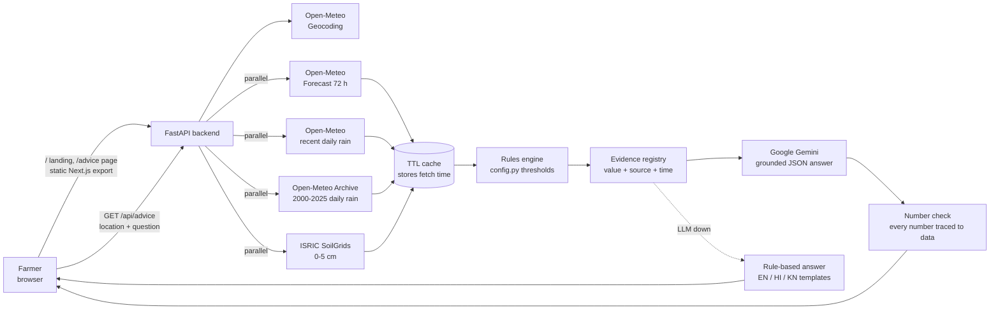

# YieldGuard – Multilingual Agritech Risk Advisor

YieldGuard gives Karnataka farmers plain-language, crop-level protective advice from **live** weather, rainfall-history and soil data, in **English, Hindi or Kannada**.

Type a village or town, ask a question in your language, and get:

- **Spray windows**: the next safe hours to spray, based on wind and rain.
- **Heavy-rain warnings** for the next 24 hours.
- **Rainfall vs normal**: this month's rain compared with the 2000–2025 average for the same dates (drought or waterlogging risk).
- **Soil-aware tips** from SoilGrids topsoil sand, clay and pH at your coordinates.
- **Irrigation planner** (an estimate): a 7-day water balance from forecast evapotranspiration and rain.
- **Heat-stress alerts** for any day above 35 °C, and **fertiliser timing** (delay if heavy rain is likely in the next 48 h).
- A **72-hour strip** of hour cells coloured by spraying safety, and big-number **field status** tiles.
- **Saved fields** (up to 5, on the device), a **Copy summary / Share on WhatsApp** card, and the **last-known answer** when live data fails.
- **Follow-up questions** under each answer, answered from the same data without fetching anything new.
- A **"why" section** that shows every data point used, with its **source and fetch time**, and the rule that was applied.

> Built for the Climate, Resource Infrastructure & Global Supply Resilience buildathon (problem: Multilingual Agritech & Resource Advisory Assistant).

**Live app:** `<add your Render URL here>`

---

## How it works



1. **Resolve location** with Open-Meteo Geocoding, restricted to Karnataka (or use browser GPS coordinates).
2. **Fetch in parallel**: the 72-hour forecast with month-to-date rainfall (one request), and SoilGrids topsoil. Each call has an 8 s timeout and one retry. Responses are cached with their original fetch time. The long-run rainfall baseline is **not** fetched during a question: it is read from `backend/data/baselines.json` (see below).
3. **Apply rules** from [`backend/app/config.py`](backend/app/config.py) (spray window, heavy rain, rainfall deficit, soil).
4. **Build the evidence registry**: every number gets an id, label, value, unit, the time it refers to, its source and its fetch time.
5. **Language model** (Google Gemini, `gemini-3.5-flash-lite`, retrying once on `gemini-3.8-flash` if it is rate-limited, overloaded or slow) gets only that evidence plus the rule outcomes and must return structured JSON whose recommendations cite evidence ids. Unknown ids are removed.
6. **Grounding check**: every number in the answer is matched against the retrieved data. Any number that can't be matched is shown to the user as "check these numbers".
7. **Failure handling**: if a source fails, the answer says which one and which parts are missing. If a live refresh fails but an earlier good response for the same place is cached (forecast up to 12 h old, month-to-date rain up to 24 h), that response is used and clearly labelled "live refresh failed, showing data fetched at …". If the language model fails, a deterministic rule-based answer is returned in the user's language.

### Open-Meteo rate limits

Open-Meteo's free tier allows 600 calls per minute, 5,000 per hour and 10,000 per day **per IP address**, and weights each call by its length (about days ÷ 14). Hosting platforms such as Render share outbound IPs between apps, so other apps' traffic counts too. YieldGuard keeps its usage low:

- **One forecast request per place**: the 72-hour forecast and this month's past daily rain come from one call (`past_days`). Cached for 60 minutes per location (coordinates rounded to 2 decimals).
- **Rainfall baseline built in the background, once per district**: one archive request for the whole period (2000-01-01 to the last full year's 12-31, `daily=precipitation_sum`). The daily values, the years used and the build time are saved to `backend/data/baselines.json` and loaded at startup; the deficit rule averages the same calendar dates from it. At startup the default district (Dharwad) is built if missing; a question for a district with no baseline yet gets "the rainfall baseline for … is not available yet; it is being built now" and the build is queued. Builds run one at a time, at least 70 s apart; a failed build is retried after 10 minutes; baselines are rebuilt after 30 days. The single 26-year request weighs about 680 Open-Meteo calls (more than the 600-per-minute limit), which is why builds are rare, spaced out and never part of a question. On Render's free plan the disk is reset on each deploy or restart, so the default district is rebuilt in the background after that.
- **SoilGrids responses are cached for 7 days per coordinate pair** and saved to `backend/.cache/soil_cache.json` (`backend/data/` holds only the rainfall baseline). If SoilGrids fails (for example HTTP 503), the saved copy is shown with its fetch time; without one, the answer says soil data is temporarily unavailable. The 60 s backoff applies only to Open-Meteo 429s, not to SoilGrids or Gemini.
- **One Open-Meteo call at a time**, and identical requests that arrive together share one call.
- **HTTP 429 is never retried straight away.** No Open-Meteo call is sent for `Retry-After` seconds, or at least 60 s, and the last good data is shown instead, labelled with its fetch time.
- **Every external call is logged** with provider, path, location, status and duration, for example `fetch open-meteo /v1/forecast latitude=15.46 longitude=75.01 past_days=30 -> 200 in 858 ms`; skipped calls are logged as `skip ... rate-limit backoff`.
- The answer panel lists **how old each piece of data is** (live, cached, or saved copy), and the language model is told to say so when a saved copy is used.

### Project layout

```
backend/
  app/
    config.py        all thresholds, URLs, timeouts, cache TTLs
    http.py          fetch with timeout + 1 retry, caching, SourceResult
    cache.py         TTL cache that keeps fetch time
    sources/         geocode, forecast (hourly + daily, one request), metno (fallback), rainfall helpers, soil
    rules/           spray, heavy_rain, deficit, soil, irrigation, heat, fertiliser
    baseline.py      per-district rainfall baseline: background build, saved to data/
    today.py         "Today in your field" summary (landing card, saved fields), cached 1 h per location
    sessions.py      in-memory sessions (cookie) holding the last answer's data for follow-ups
    followup.py      follow-up answers from the stored data: limits, data-age check, grounding
    evidence.py      data points + rule outcomes with source and time
    prompts.py       system prompt + JSON output schema
    llm.py           Gemini call (JSON schema output, fallback model on rate limit)
    fallback.py      rule-based answer in EN / HI / KN
    grounding.py     numbers-in-answer verification
    language.py      script-based language detection
    advisor.py       orchestration for one request
    main.py          FastAPI app and routes, serves the built frontend (web/out)
  tests/             127 tests; fixtures are real API responses (tests only, never imported by app/)
  devtools/          USE_FIXTURES=1 local dev server (never used in deployment)
web/                 Next.js (App Router, TypeScript, Tailwind), built as a static export
  app/page.tsx         landing page (shader background, TextRoll title, live "Today in your field" card)
  app/advice/page.tsx  advice dashboard
  components/          AdviceApp, AdviceResult, AnswerSections, FollowUps, HourStrip, FieldPlanner (irrigation table),
                       SavedFields, ShareBar, TodayCard, MicButton, DataRain, LandingBackground, TextRoll, AttributionFooter
  tests/               vitest: answer layout order (fixture = a saved real /api/advice response)
  lib/                 API client, types, EN/HI/KN labels, formatting, device storage, voice
render.yaml          deployment blueprint (no secrets)
```

---

## Data sources and attribution

| Data | Source | Notes |
|---|---|---|
| Place → coordinates | [Open-Meteo Geocoding API](https://open-meteo.com/en/docs/geocoding-api) | Filtered to Karnataka, larger towns first |
| 72-hour hourly forecast | [Open-Meteo Forecast API](https://open-meteo.com/en/docs) | hourly `temperature_2m, relative_humidity_2m, precipitation_probability, precipitation, wind_speed_10m`, `forecast_hours=72`, `timezone=Asia/Kolkata` |
| Daily forecast and month-to-date rain | Same request (no extra call) | daily `precipitation_sum, et0_fao_evapotranspiration, temperature_2m_max`, `forecast_days=7`, `past_days` back to the 1st of the month. Cached 60 min per location |
| Long-run rainfall baseline | [Open-Meteo Historical Weather API](https://open-meteo.com/en/docs/historical-weather-api) | 2000 to last full year, same calendar dates; one request per district, built in the background, saved to `backend/data/baselines.json`, rebuilt after 30 days |
| Forecast fallback | [MET Norway Locationforecast 2.0 (compact)](https://api.met.no/weatherapi/locationforecast/2.0/documentation) | Used **only** when Open-Meteo returns 429 or 5xx. Identifies itself as `YieldGuard/1.0 (contact: METNO_CONTACT)`; coordinates rounded to 4 decimals; cached until its `Expires` header and revalidated with `If-Modified-Since`; wind converted from m/s to km/h (× 3.6) before any rule runs. Every value is labelled "MET Norway fallback" with its fetch time. It has no rain probability, ET0 or past rainfall, so those parts show as unavailable. |
| Baseline fallback | [NASA POWER daily point API](https://power.larc.nasa.gov/docs/services/api/temporal/daily/) | `parameters=PRECTOTCORR`, `community=AG`, 2000–2025. Used **only** in the background build, when the Open-Meteo archive fails **and** no baseline is saved for the district. `-999` (fill value) is stored as missing and excluded from every average. Saved to `backend/data/baselines.json` labelled "NASA POWER" with its build date. Never called during a question. |
| Topsoil properties | [ISRIC SoilGrids v2.0](https://rest.isric.org/soilgrids/v2.0/docs) | `clay, sand, phh2o, soc`, `depth=0-5cm`, `value=mean`; cached 7 days per coordinate pair, saved to `backend/.cache/soil_cache.json`; on a 503 the saved copy is shown with its fetch time |
| Answer writing | [Google Gemini API](https://ai.google.dev/) | Uses only the data above. Free tier: prompts may be used by Google to improve its products, so only public weather/soil data and the question are sent. |
| Voice questions (optional) | Google Gemini API (audio input) | Only when the farmer taps **Speak**. The recording is sent to Gemini for transcription and is not stored by YieldGuard. Same free-tier caveat as above. |

**Third-party code:** [Motion](https://motion.dev) (MIT) for the title animation. The landing background (DataRain) is written for this project.

**Attribution:** Weather data by [Open-Meteo.com](https://open-meteo.com/), licensed [CC BY 4.0](https://creativecommons.org/licenses/by/4.0/). Soil data: SoilGrids v2.0, [ISRIC – World Soil Information](https://www.isric.org/), CC BY 4.0. Fallback forecast: [MET Norway](https://api.met.no/) (Norwegian Meteorological Institute), CC BY 4.0 / NLOD 2.0. Fallback baseline: [NASA POWER](https://power.larc.nasa.gov/) project, NASA Langley Research Center.

**SoilGrids unit conversion:** values are stored as integers scaled by `d_factor` (read from each response): clay and sand g/kg ÷ 10 → %, pH × 10 ÷ 10 → pH, SOC dg/kg ÷ 10 → g/kg.

**Urban pixels:** SoilGrids masks built-up areas (for example, Dharwad city centre returns `null`). We then query points about 2 km away, one at a time to respect ISRIC's fair-use limit, and show the distance used ("2.2 km from the location").

**Rainfall caveat:** month-to-date rain comes from the forecast model's recent analysis and the baseline from ERA5 reanalysis. Both are gridded model estimates, not rain-gauge readings.

---

## Advisory rules

All thresholds are in [`backend/app/config.py`](backend/app/config.py) and also served live at `GET /api/rules`.

| Rule | Condition | Advice |
|---|---|---|
| Spray window | `wind_speed_10m < 10 km/h` AND `precipitation_probability < 20%` AND `precipitation = 0`, for **≥ 3 consecutive hours**, daylight 06:00–19:00 only (`SPRAY_ALLOWED_HOURS`, set `None` to allow any hour). Missing values count as unsafe. | Earliest 1–3 windows |
| Heavy rain | Next 24 h: any hour `precipitation_probability > 70%` OR total rain `> 40 mm` | Postpone field work, check drainage |
| Rainfall deficit | Month-to-date rain (1st to yesterday) as % of the 2000–2025 mean for the same dates. On the 1st, the previous full month is used. | `< 60%` drought risk, `> 150%` waterlogging risk. If normal rain is below 5 mm (dry season), no % is given. |
| Soil | sand `> 60%`; clay `> 40%`; pH `< 5.5` or `> 8.5` | Lighter, more frequent irrigation; caution in heavy rain; get a soil test |
| Irrigation planner (estimate) | For each of the next 7 days: crop use = `et0_fao_evapotranspiration × CROP_FACTOR` (0.85); running deficit = previous deficit + crop use − rain, never below 0, starting at 0 today | Irrigate on the first day the deficit exceeds `IRRIGATION_DEFICIT_MM` (25 mm). Labelled an estimate; the calculation is shown in "Why this advice" |
| Heat stress | `temperature_2m_max > HEAT_THRESHOLD_C` (35 °C) on any of the next 7 days | Amber alert with the date: irrigate early or late, avoid afternoon spraying, shade and water for animals |
| Fertiliser timing | Next 48 h (`FERTILISER_LOOKAHEAD_H`): any hour `precipitation_probability > 70%` OR total rain `> 40 mm` | Delay fertiliser: rain soon after application leaches nutrients below the roots or washes them off the field |

### Config values (`backend/app/config.py`, each commented in the file)

| Setting | Value | Meaning |
|---|---|---|
| `SPRAY_MAX_WIND_KMH` / `SPRAY_MAX_PRECIP_PROB_PCT` / `SPRAY_MAX_PRECIP_MM` | 10 / 20 / 0 | spray-window weather limits |
| `SPRAY_MIN_HOURS` / `SPRAY_MAX_WINDOWS` / `SPRAY_ALLOWED_HOURS` | 3 / 3 / 06–19 | window length, how many, daylight only |
| `HEAVY_RAIN_PROB_PCT` / `HEAVY_RAIN_TOTAL_MM` / `HEAVY_RAIN_LOOKAHEAD_H` | 70 / 40 / 24 | heavy-rain warning |
| `FERTILISER_RAIN_PROB_PCT` / `FERTILISER_RAIN_TOTAL_MM` / `FERTILISER_LOOKAHEAD_H` | 70 / 40 / 48 | fertiliser delay |
| `DEFICIT_DROUGHT_PCT` / `DEFICIT_WATERLOG_PCT` / `DEFICIT_MIN_BASELINE_MM` | 60 / 150 / 5 | rainfall vs normal |
| `HEAT_THRESHOLD_C` | 35 | heat-stress day |
| `CROP_FACTOR` / `IRRIGATION_DEFICIT_MM` / `FORECAST_DAILY_DAYS` | 0.85 / 25 / 7 | water balance |
| `SOIL_SAND_HIGH_PCT` / `SOIL_CLAY_HIGH_PCT` / `SOIL_PH_LOW` / `SOIL_PH_HIGH` | 60 / 40 / 5.5 / 8.5 | soil flags |
| `TTL_FORECAST` / `TTL_TODAY` / `TTL_SOIL` / `TTL_BASELINE` | 1 h / 1 h / 7 days / 30 days | caches |
| `RATE_LIMIT_BACKOFF_S` | 60 | Open-Meteo-only pause after HTTP 429 |
| `SESSION_TTL_S` / `FOLLOWUP_LIMIT` / `FOLLOWUP_WINDOW_S` / `FOLLOWUP_MAX_DATA_AGE_S` | 30 min / 10 / 30 min / 60 min | follow-up sessions, limit and data age |

---

## Frontend

- **Framework:** Next.js 16 (App Router, TypeScript, Tailwind CSS v4) with `output: "export"`. `npm run build` writes plain HTML/JS/CSS to `web/out`, which FastAPI serves, so the site and the API share one URL and need no CORS setup.
- **Design: a field-status dashboard.** Theme "Sage Garden" (all colours are CSS variables in [`web/app/globals.css`](web/app/globals.css)): primary `#7d9a86`, background `#111111`, card `#1a1a1a`, border `#2a2a2a`, muted text `#a3a8a4` (7.8:1), amber `#d97706` for drought, waterlogging, heat, heavy-rain and fertiliser warnings, red `#ef4444` only for errors. All text colours pass WCAG AA. Fonts via `next/font`: Inter for Latin text, Noto Sans Kannada and Noto Sans Devanagari for the other scripts; body text 16 px, large numbers for temperature, rain chance, wind and soil. One column on phones, two on wider screens; touch targets at least 44 px.
- **Landing (`/`):** a light green-to-blue gradient (`#eaf7ef` → `#e6f1fb`) with a **DataRain** flow-field animation above it ([`DataRain.tsx`](web/components/DataRain.tsx): particles falling through a slowly turning flow field, coloured by speed in blue `#1e88e5`, green `#2e7d32` and teal `#00897b`, with dark `#0d3b2e` head sparks, a soft bloom, and a light vignette and grain). It uses about 1,800 particles on phones and 3,500 on desktops, draws a single still frame when the device asks for reduced motion, and ignores pointer events so everything above it stays clickable. `theme="dark"` (the default) keeps the original look for other uses. Dark text (`#0f2a1d`, 13.4:1 or better; tagline `#14532d`, 8.0:1 or better) sits on a 75% white panel so particles never reduce its contrast. Then the title animated once per page load with [`TextRoll.tsx`](web/components/TextRoll.tsx) (using [`motion`](https://motion.dev)), the tagline "From sky to soil, every season", and a live **"Today in your field"** card for the selected saved field (default Dharwad): the next spray window, the rain chance for the next 24 h and the soil summary, each with its time and source. It reads `GET /api/today`, which the server caches for one hour per location, so a location is refreshed from the APIs at most once an hour.
- **72-hour strip:** 72 hour cells, sage = safe to spray (wind and rain below the spray limits), amber = risky, red = data missing. Tap a cell for its wind, rain chance, rain, temperature and humidity, with source and fetch time.
- **Saved fields:** up to 5 places stored in `localStorage` (every access in `try/catch`, so the app still works when storage is blocked). Each shows its next spray window and warnings from `/api/today`; one tap switches field (and re-asks if a question is typed). No accounts, no database.
- **Copy summary / Share on WhatsApp:** plain text with the place, the advice in the selected language, fetch times and sources; the WhatsApp link is `https://wa.me/?text=` with the encoded summary.
- **Last-known answer:** the last answer for each place is kept on the device. If the live request fails, or a source fails, the saved answer is shown with "Last updated … ago" and the name of the failed source.
- **Voice input:** tap **Speak**, say the question, tap **Stop** (auto-stops after 30 s). The browser records with `MediaRecorder`, shows the input level, rejects silent recordings locally ("check that the right microphone is selected"), converts the audio to 16 kHz mono WAV, and posts it to `/api/transcribe`, where Gemini transcribes it in English, Hindi (Devanagari) or Kannada (Kannada script). The text goes into the question box so the farmer can check it before asking. This replaced the browser's `SpeechRecognition`, which sends audio to Google from Chrome only, fails in Brave and Opera, and has patchy Kannada support.
- **Advice (`/advice/`):** location (default Dharwad, with Karnataka place suggestions and GPS), question, language (Auto / English / हिन्दी / ಕನ್ನಡ), a **Speak** button for voice questions, and a **Listen** button that reads the answer aloud when the browser has a voice for that language. It shows loading, empty and error states, a red notice for each failed source saying which part of the answer is missing, amber warnings, the answer with a "Why this advice" section, the rules applied, the 72-hour strip, the irrigation planner, heat and fertiliser cards, a table with value, data date, source and fetch time for every number, and the attribution footer.

## Answer layout

Every answer uses the same order, on a 12-column grid on desktop and one column on phones (labels left, numbers right, equal spacing):

1. **Summary bar**: the answer in one sentence, a status badge (OK / Warning / Data missing), the place and the fetch time.
2. **Now**: three equal cards (temperature, rain chance next 24 h, wind) with unit, time and source; a missing value shows "–" and "not available".
3. **Next 72 hours**: the hour strip, with a time label on every fourth cell.
4. **Alerts**: one row per alert (date, rule, advice); amber for warnings and fallbacks, red for errors.
5. **Advice**: short sentences, one numbered action per line, each with its source and times.
6. **Why this advice** (collapsed): a table of rule, input values and result, plus the day-by-day irrigation balance.
7. **Data and sources**: source, what it supplied, fetch time and status (live, cached, saved copy, fallback, unavailable).
8. **Share** (Copy summary, WhatsApp) and the **follow-up** box.

## Follow-up questions

Below each answer is a follow-up box ("What about Sunday morning?").

- **Stored, not refetched.** When a full answer is made, its data (location, every data point with source and fetch time, rule results, the 72-hour and 7-day forecast rows) is kept **in server memory** in a session, keyed by an `HttpOnly`, `SameSite=Lax` cookie (`yg_session`). No database. Sessions expire 30 minutes after last use, and a server restart clears them.
- **No new API calls.** `POST /api/followup` answers only from that stored data: it never calls Open-Meteo or SoilGrids (a test cuts off every data source and checks that nothing is called). Only Gemini is called.
- **Grounded.** Gemini gets the stored data and the question, must cite the ids it used (data points, `rule:…`, `hour:…`, `day:…`), and must say when the data does not cover the question. Unknown ids are dropped, and an answer that cites nothing from the stored data is treated as **not covered**, whatever the model says. Numbers are checked against the stored data like full answers.
- **Shown below the previous answer** with its own "Why this answer" section (each citation with source, data time and the **original fetch time**).
- **Data age.** If the stored forecast is more than 60 minutes old, the follow-up is not answered; the page says so and offers **Refresh data**, which runs a new full request.
- **Limit.** 10 follow-ups per session per 30 minutes; the page shows how many are used and a clear message when the limit is reached.

## Run locally

Requirements: Python 3.11+ and Node.js 20.9+.

```bash
cp .env.example .env          # then put your key in .env (never commit it)
# Windows
.\run.ps1
# macOS / Linux
./run.sh
```

The run scripts build the frontend once (if `web/out` is missing) and start the API. Open http://localhost:8000.

For frontend work with hot reload, keep the API running on port 8000 and in another terminal run `cd web && npm run dev`, then open http://localhost:3000. In development the page calls the API on `http://localhost:8000`. Get a free Gemini key at https://aistudio.google.com/app/apikey. Without `GEMINI_API_KEY` the app still works and uses the rule-based answer.

### Local development with saved responses (`USE_FIXTURES=1`)

To work on the UI without calling Open-Meteo or SoilGrids (for example while rate-limited), start the dev server with saved real API responses:

```powershell
$env:USE_FIXTURES = "1"; .\run.ps1        # Windows
USE_FIXTURES=1 ./run.sh                   # macOS / Linux
```

- It runs `devtools.fixture_server:app` instead of `app.main:app`. The responses are the real ones saved in `backend/tests/fixtures/` (see `manifest.json` for when each was captured). Only **Dharwad** is available; other places return "not found".
- The clock is frozen at the forecast's capture time so spray windows and month-to-date rain line up with the saved forecast. Gemini is still called live if `GEMINI_API_KEY` is set.
- Every answer is labelled: a red **TEST MODE** banner on the page, `[SAVED TEST RESPONSE]` on every source, `"fixture_mode": true` in the JSON, and an `X-YieldGuard-Data: saved-test-responses` header.
- **It cannot run in the deployed app.** The fixture code lives in `backend/devtools/`, which `backend/app/` never imports (a test checks this). Render's start command is `uvicorn app.main:app`, which ignores `USE_FIXTURES`, and the fixture server refuses to start if `RENDER` is set or `USE_FIXTURES` is not `1`.
- `USE_FIXTURES` is read from the shell, not from `.env`.

Frontend tests (layout order, missing values, sentence splitting): `cd web && npm test`.

Run the backend tests:

```bash
cd backend
../.venv/Scripts/python -m pytest -q     # Windows
../.venv/bin/python -m pytest -q         # macOS / Linux
```

Demo link format: `/advice/?location=Hubballi&q=Can+I+spray+tomorrow%3F&lang=kn` fills the form and runs the query.

### API

| Endpoint | Purpose |
|---|---|
| `GET /api/advice?q=…&location=…&lang=auto\|en\|hi\|kn` (or `&lat=…&lon=…`) | Full answer with data points, rules, sources, timestamps |
| `GET /advice?location=…&question=…&lang=en\|hi\|kn` | Same JSON as `/api/advice`. Without `question`, `/advice` serves the advice page. |
| `POST /api/transcribe?lang=auto\|en\|hi\|kn` | Body: 16-bit PCM WAV (max 30 s). Returns `{text, language, model, transcribed_at}` |
| `GET /api/today?location=…` (or `&lat=…&lon=…`) | "Today in your field": next spray window, rain chance next 24 h, soil summary, warnings, with fetch times. Cached 1 h per location; no language model |
| `POST /api/followup` (JSON `{"question", "lang"}`, session cookie) | Follow-up answered from the last answer's stored data. Errors: `409 no_session`, `409 data_stale` (older than 60 min), `429 followup_limit` |
| `GET /api/locations?q=…` | Karnataka place search |
| `GET /api/rules` | Thresholds in use |
| `GET /api/health` | Status, whether the LLM key is configured (never the key itself), and which rainfall baselines are stored, building or failed. Calls no external service. |

Errors return JSON `{"error": {"code", "message"}}`: `404 location_not_found`, `503 geocoding_failed`, `422` for empty questions or coordinates outside Karnataka.

---

## Deploy (Render)

1. Push this repository to GitHub.
2. In Render, create a **Blueprint** from the repo (it reads `render.yaml`), or a Web Service with:
   - Build: `pip install -r backend/requirements.txt && cd web && npm ci && npm run build`
   - Start: `cd backend && uvicorn app.main:app --host 0.0.0.0 --port $PORT`
3. In the Render dashboard, set **`GEMINI_API_KEY`**. It is never stored in the repository.
4. Open `/api/health` on the live URL and check that `llm_configured` is `true`, then open `/` and `/advice/`.

### Environment variables

| Variable | Required | Default | Purpose |
|---|---|---|---|
| `GEMINI_API_KEY` | Yes (for LLM answers) | – | Google Gemini key. Without it, the rule-based answer is used. |
| `GEMINI_MODEL` | No | `gemini-3.5-flash-lite` | Main Gemini model (`LLM_MODEL` is also accepted) |
| `LLM_FALLBACK_MODEL` | No | `gemini-3.8-flash` | Used once if the main model is rate-limited or down |
| `LLM_THINKING_LEVEL` | No | `low` | `minimal`, `low`, `medium` or `high` |
| `LOG_LEVEL` | No | `INFO` | Server log level |
| `PYTHON_VERSION`, `NODE_VERSION` | Render only | `3.12.8`, `22.12.0` | Set in `render.yaml` |
| `NEXT_PUBLIC_API_BASE` | No | same origin | Only for hosting the frontend separately from the API |
| `METNO_CONTACT` | Recommended | – | Email or URL for MET Norway's User-Agent (forecast fallback). Empty = fallback off |
| `CORS_ORIGINS` | No | `http://localhost:3000,http://127.0.0.1:3000` | Origins allowed to send the session cookie cross-origin (Next.js dev server only) |
| `YIELDGUARD_DATA_DIR` / `YIELDGUARD_CACHE_DIR` | No | `backend/data`, `backend/.cache` | Where the rainfall baseline and the SoilGrids cache are saved |

## Security

- No API keys in code. `.env` is in `.gitignore`; `.env.example` holds placeholders only.
- The farmer's question is passed to the model as data inside tags, and the system prompt tells the model to ignore instructions inside it.
- The UI renders all text through React (escaped by default; no `dangerouslySetInnerHTML`).

## Roadmap

- Mandi sell-or-hold advice, once an official data.gov.in / Agmarknet API key and resource ID are available.
- Crop calendar awareness (sowing dates, growth stage).
- SMS / WhatsApp delivery for farmers without smartphones.
- District-level Soil Health Card data as a labelled background layer.
- Rain-gauge (IMD/KSNDMC) observations for month-to-date rainfall.

## Team

`<add team names>`
